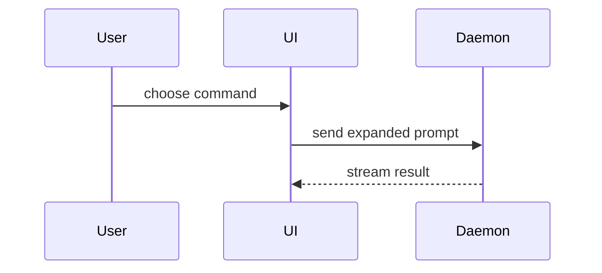

## Shared contract context

When working in a project repository, read CONTRATOS.md, context/README.md, context/project.md, context/glossary.md and the active feature's contract.md and context.md before acting. Project knowledge lives in context/; feature knowledge lives in context/features/<feature>/; shared model and module contracts live in contracts/. These locations take precedence over legacy glossary, scratch, ADR and temporary-file conventions elsewhere in this skill or its supporting references.

Use node contract-tools/scripts/contracts.mjs docs --root . to create missing project documentation without overwriting existing files. Start a new feature with init on feature/<id>-<name>; docs alone does not create a valid feature contract. Reuse the active feature branch for its tickets, research and prototypes. Do not create a second integration or prototype branch for that feature by default. If there is no repository or feature, keep standalone work standalone; do not invent a feature. For read-only tasks, report missing documentation instead of writing it.

Keep one canonical glossary at context/glossary.md and durable decisions under context/decisions/. Migrate existing glossary or ADR content deliberately, preserving links and history; do not silently replace an existing glossary with an empty file. Feature tickets, research and prototype decisions belong under context/features/<feature>/ and must reference the contract and acceptance IDs. An external tracker can mirror or link this source when authorized, but is not a prerequisite for local contract work. Never create issues in the upstream skills repository just because its origin is configured.

Update the relevant project and feature documentation when knowledge changes. Preserve facts, assumptions, evidence and next steps distinctly. Do not declare completion without recorded evidence and structural validation. Include code, contracts and context in the same feature PR; check that documentation is neither ignored nor left outside Git. Saving, committing and pushing are separate actions: only claim GitHub sharing after an authorized, verified push. Do not publish, merge, commit or delegate merely because another section describes that as a default; use existing user authorization. Authorized subagents must start with a fresh context window and receive pointers to these versioned artifacts.

Use this template for writing the PR body:

```markdown
## Summary

<diagram, diff-sketch, or tree>

## Evidence

- **Before:** <screenshot/output/failing test run>
  **After:** <screenshot/output/passing test run>

## Merge Danger

**Door:** <one-way or two-way>

<optional: description>

**Blast Radius:** <one-word description>

<optional: potential ramifications of merge>
```

## Sections

Skip all preambles and keep prose brief. Use the user's domain language from `GLOSSARY.md`.

### Summary

Pick the smallest view that makes the key point clear.

- Show logic or an algorithm as pseudocode:

```text
on(save)
  if content is unchanged
    return cached result
  write new content
  return fresh result
```

- Show runtime control flow as a call tree:

```text
submitForm
  createSession
    persistPrompt
    launchAgent
  navigateToSession
```

- Show UI structure as a component tree, including state and module boundaries that matter:

```text
<SessionPage> (apps/example/src/routes/session.tsx)
  useSessionEvents()
  <SessionToolbar>
    <RunSkillButton> (packages/ui)
```

- Show file responsibility or a broad refactor as a shallow file tree:

```text
src/
├── commands/       # parses user actions
├── sessions/       # owns session state
└── transport/      # sends API requests
```

- Show component interaction, control flow, or data flow with Mermaid:



- Use `diff` when the point is what changes and the surrounding shape already exists. Match the diff shape to the topic.

For a component change:

```diff
 <SessionPage>
   useSessionEvents()
   <SessionToolbar>
+    <RunSkillButton />
   <SessionTimeline>
+    <SkillResultCard />
```

For a file-layout change:

```diff
 src/
 ├── commands/
+│   └── show-me.ts       # expands the slash command
 ├── sessions/
-└── transport.ts
+└── transport/
+    ├── client.ts
+    └── stream.ts
```

For a call-tree or call-stack change:

```diff
 submitForm
   createSession
     persistPrompt
+    expandSkillMention
     launchAgent
-  navigateToSession
+  navigateToSession
+    subscribeToEvents
```

For a state or control-flow change:

```diff
 on(save)
-  write content
+  if content is unchanged
+    return cached result
+  write new content
+  invalidate cache
```

- Show the whole block when most of it is new, when omitted context would hide ownership or order, or when the user needs a copyable target shape:

```ts
function expandSkill(command: string): string {
  const skillName = command.slice(1);
  return `use the ${skillName} skill`;
}
```

#### Guidance

Place each visual next to the short text it supports. Keep only the calls, files, props, states, and boundaries needed to answer the user's current question or the options to resolve the current discussion point.

You may use one of these, you may use several, it is unlikely you will use all of them. Use your judgement and don't overwhelm the user.

### Evidence

Concrete evidence that the change works. Show a before and after.

Screenshots are S-tier - when the environment is set up for it and the change is visual.

Execution-based evidence is A-tier. Test results, console output. Show the exact test that now fails and passes, using pseudocode.

### Merge Danger

Describe whether it's a one-way or two-way door. You can walk back through two-way doors, but not one-way doors. A PR that is cheap to roll back is lower risk. Changes that involve destructive actions or hard-to-reverse decisions are one-way doors.

The blast radius is the potential impact or scope of the changes introduced by this PR. Consider all possibilities. Examples are layout shift, breakages for consumers, mobile responsiveness, etc.
